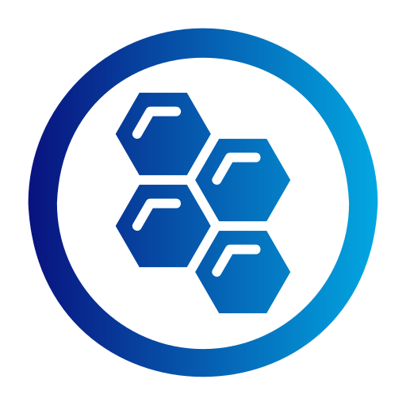
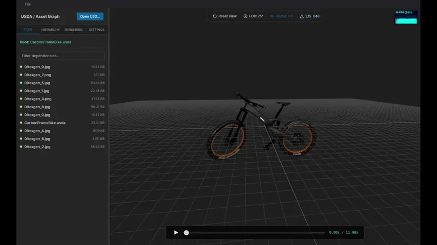

#  USDBEE

<p align="center">
  
</p>

> Lightweight USD viewer built with Tauri, and Three.js.

[](https://www.rust-lang.org/)
[](https://docs.rs/openusd/0.8.0/openusd/)
[](https://tauri.app/)
[](https://svelte.dev/)
[](https://threejs.org/)
[](https://opensource.org/licenses/MIT)
[](https://github.com/ThomasByr)

1. [Installation](#installation)
2. [Usage](#usage)
3. [Notes](#notes)

## Installation

### Pre-built binaries

> [!NOTE]
> You can download the latest release of USDBEE for your system from the [Releases](https://github.com/ThomasByr/usdbee/releases) page.

Please download the appropriate installer for your operating system, run the installer, and follow the installation instructions.

On MacOS, both Intel and Apple Silicon architectures are supported.

### Building from source

To build USDBEE from source, make sure you have [Node.js](https://nodejs.org/)
(with npm - [fnm](https://github.com/Schniz/fnm) is recommended),
[Rust](https://www.rust-lang.org/tools/install) and
[Tauri prerequisites](https://tauri.app/start/prerequisites/) installed.

Then, clone the repository and run the following commands in the project directory:

```sh
npm install
npm run tauri build -- --no-bundle
```

This will create the application binary in the `src-tauri/target/release` directory.

Run the application with:

```sh
./src-tauri/target/release/usdbee
```

or

```ps1
& ./src-tauri/target/release/usdbee.exe
```

You can also run the application in development mode with:

```sh
npm run tauri dev
```

### Generating bundles

Bundles are located in `src-tauri/target/release/bundle`. You can bundle a release target with:

```sh
npm run tauri bundle
```

or run the plain `npm run tauri build` command to build and bundle in one step.

## Usage

Run the application and use <kbd><kbd>Ctrl</kbd>+<kbd>O</kbd></kbd> to load a USD file.
Press <kbd><kbd>Ctrl</kbd>+<kbd>E</kbd></kbd> to export a render view of the current scene.

Navigate the 3D view with your keyboard and mouse. Check the "SETTINGS" tab to customize the controls.

To get the file used in the demo, you can use the [Carbon Frame Bike](https://github.com/usd-wg/assets/tree/main/full_assets/CarbonFrameBike).

```sh
curl -L -o assets/CarbonFrameBike.usdz https://github.com/usd-wg/assets/raw/refs/heads/main/full_assets/CarbonFrameBike/CarbonFrameBike.usdz
```

Then open the `assets/CarbonFrameBike.usdz` file in USDBEE.

### Command line

```txt
usage: usdbee [-h] [-p x,y,z | --camera-position x,y,z] [-t x,y,z | --camera-target x,y,z] [-f fov | --camera-fov fov] [FILE...]
```

Pass one or more USD files to open them as tabs on startup.

- `-p` / `--camera-position` sets the camera location and
- `-t` / `--camera-target` sets the point it looks at, in world units.
- `-f` / `--camera-fov` sets the field of view, in degrees.

Both `-p` and `-t` take three numbers, written `1,2,3` or `1 2 3`.

```sh
./usdbee scene.usda
./usdbee -p 4,3,6 -t 0,0,0 -f 90 scene.usda other.usdz
./usdbee --camera-position 4 3 6 scene.usda
```

> [!Warning]
> On Windows release builds, the binary uses the GUI subsystem.
> Nothing attaches a console: `-h` / `--help` prints nothing and a flag error exits with status 1 silently.

### Command palette

<kbd><kbd>Ctrl</kbd>+<kbd>P</kbd></kbd> (<kbd><kbd>Cmd</kbd>+<kbd>P</kbd></kbd> on macOS) opens the command palette.
This keybinding, and whether <kbd>Tab</kbd> runs the highlighted command, are set in SETTINGS under "Keybindings & Control".

## Notes

<details>
<summary>USD files</summary>

USDBEE understands `.usda`, `.usdc`, `.usd` and `.usdz` (unpacked to the temp cache on open). It renders polygon
meshes, basis and NURBS curves, points, spheres, point instancers, variants, skinning and animation, with PNG/JPEG,
EXR and GPU-native KTX2 textures and UDIM tiles on the diffuse slot. NURBS surfaces are not drawn, basis-compressed
KTX2 falls back to the material colour, and `.hdr` files are not sampled.

Materials are UsdPreviewSurface only. MaterialX and MDL shaders are not read: a scene that references a `.mtlx` file
still opens, and the skipped files are listed in the Stage messages dialog. UsdLux lights drive the viewport with
Lighting source when set to Auto or Scene.

</details>

<details>
<summary>Tauri Asset Sandboxing</summary>

`asset://` reads current through the assetProtocol scope in `tauri.conf.json`.
`**` covers every path except unix dot-directories (`~/.cache`, `~/.local/share`), which need their own `$LOCAL_DATA/**`-style entry.
Extraction stays under `std::env::temp_dir()/usdbee/cache`, so it needs nothing extra.

</details>
